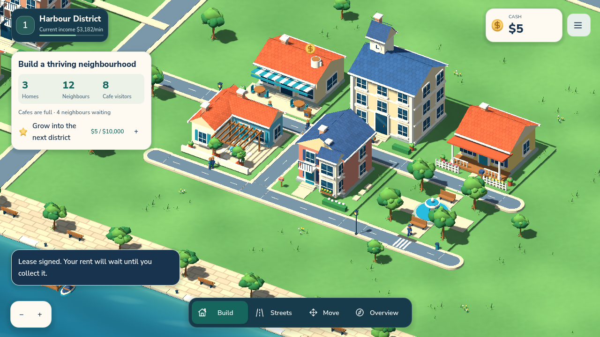
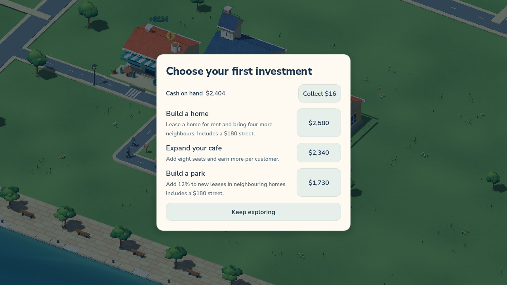

# Harbour & Home

Harbour & Home is a single-player property game set in a seaside neighbourhood. Sign leases, connect homes and shops with streets, and decide how to invest what the neighbourhood earns.



## Play from source

1. Install Godot 4.7.1.
2. Import `project.godot` in the Godot Project Manager.
3. Press **F5**, then select **Start building**.

On Windows, you can also run `play-windows.cmd` with `godot` on your PATH. If your Godot executable has a different name, set `CITY_GODOT_EXE` to its path. The game supports English and Turkish.

Drag to pan. Zoom with the mouse wheel or pinch on a touch screen. Use **Build** and **Streets** to develop the neighbourhood, and **Esc** to open the menu.

## The first investment

Start with $2,400, two homes and a working café. Sign the vacant home's lease, collect café earnings and choose your first investment. A home brings rent and potential customers. Expanding a café serves more neighbours when demand is there. A park increases future rents on adjacent properties. Street connections and café capacity determine where customers can go.



## Project layout

| Path | Contents |
| --- | --- |
| `scripts/model` | Leases, street connectivity, commerce, building and progression |
| `scripts/ui` and `scripts/world` | Interface, camera, placement and the rendered town |
| `assets` | Editable Godot models, audio, fonts and icons |
| `data` | Building catalogue and English/Turkish strings |
| `tests` | Model, migration, scene and input checks |

Run the opening economy checks after importing the project.

```sh
godot --headless --path . --script res://tests/test_opening.gd
```

Version 0.6.6 is a playable development build. The project includes Windows, Android and iOS export presets. Font notices and audio credits are included in [assets/fonts](assets/fonts) and [assets/audio/LICENSES.md](assets/audio/LICENSES.md).
